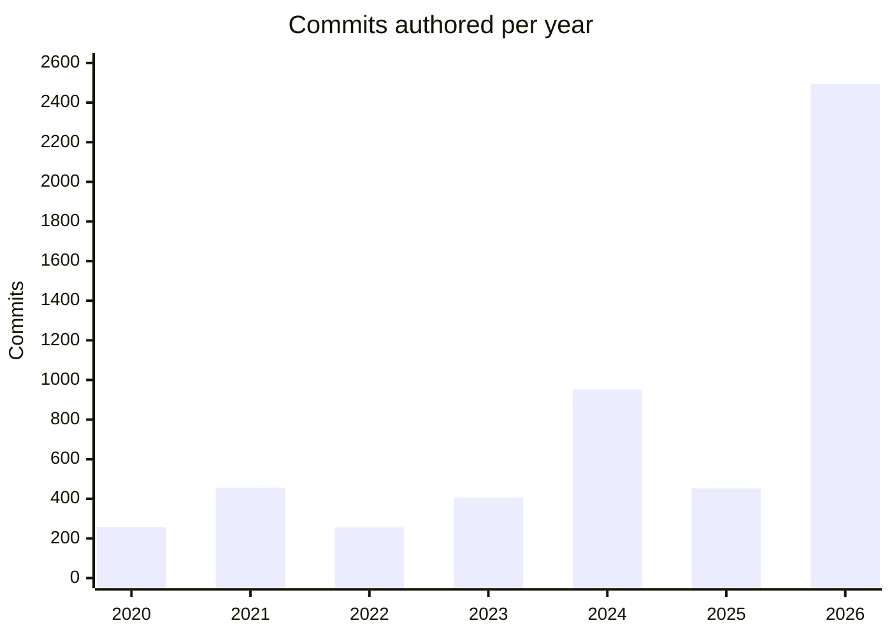
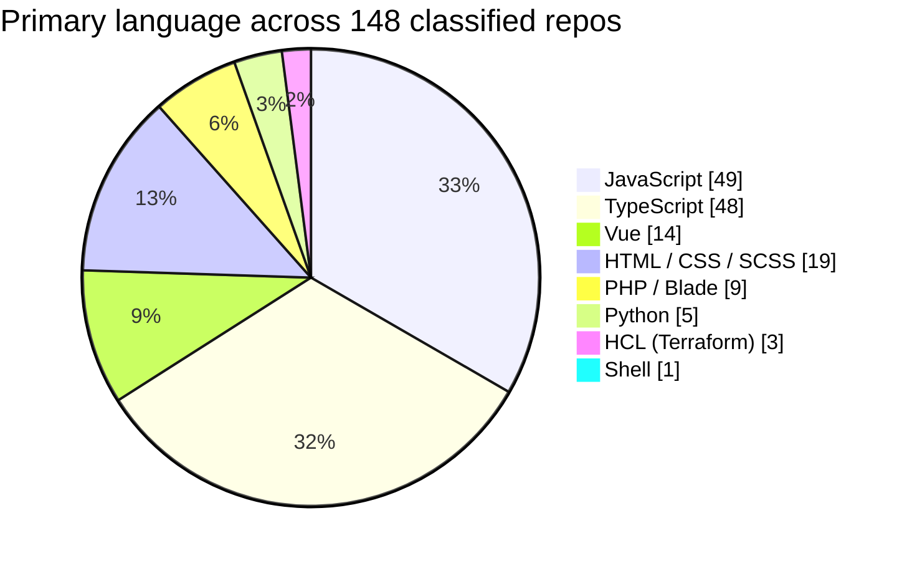

# Ubong Eduok

  

  
  
  

  
  
  
  

I build end-to-end products across backend, web, mobile, admin tooling and cloud infrastructure, with a focus on fintech, marketplaces, EdTech and gaming. I also teach DevOps through an open curriculum and a companion deployment toolkit.

---

## GitHub analytics

> Snapshot from the GitHub API, **November 2026**, private repositories included. Most of my work is in private product repos, so public-only counters show much less.

| Metric | Value |
|:---|---:|
| Total repositories | **171** |
| Private / public | 153 / 18 |
| Original repos (no forks) | 171 |
| Total commits authored | **5,276+** |
| Commits in the last 12 months | **2,586** |
| Repositories created in 2026 | 45 |

  

  

---

## Courses and toolkits

| Project | What it is |
|:---|:---|
| [**DevOps Roadmap: Beginner to Senior**](https://github.com/mascot200/devops-roadmap) | Hands-on course I wrote and teach: 21 levels from Linux to platform engineering, with a capstone per level and 9 end-to-end projects |
| [**devops-deploy-toolkit**](https://github.com/mascot200/devops-deploy-toolkit) | Companion kit of Claude Code agents, skills and scripts for approval-gated deployments to a VPS, AWS, Kubernetes or GitOps |
| [**Cybersecurity Roadmap**](https://github.com/mascot200/cybersecurity-roadmap) | 12-month, project-led AppSec and cloud security course for developers |

---

## Top projects

Private, multi-repo platforms I built. Happy to walk through them in an interview.

| Product | Domain | Repos | Stack |
|:---|:---|:---:|:---|
| **SureTrada** | AI prediction marketplace | 7 | Next.js, React Native, Terraform |
| **Esumoni** | Cooperative and ajo savings (fintech) | 4 | NestJS, PostgreSQL, AWS ECS, Temporal, React Native |
| **Winovaa** | Skill gaming and fantasy sports | 3 | Next.js PWA, React Native |
| **Scholora** | Live tutoring for learners aged 5–17 | 6 | NestJS microservices, PostgreSQL, Next.js, React Native |
| **WagerVerse** | Competitive gaming wagers | 4 | Next.js, Terraform, observability |
| **RentSafeDirect** | Property rental and sales marketplace | 4 | Node.js, MySQL, Socket.io, React Native |
| **Caretakeer** | Agent-free property rentals | 3 | Next.js, Firebase, React Native |
| **Korixa Labs** | AI platform for startup founders | 3 | NestJS (Fastify), Supabase, web, React Native |
| **BlaqPlate** | Restaurant ordering, payments and loyalty | 3 | Next.js, React Native, Flutterwave, Mapbox |
| **Floki** | Ride-hailing and mobility | 4 | Backend, rider app, driver app, admin |

---

## Experience

| Role | Company | Period |
|:---|:---|:---|
| Senior Full-Stack Engineer | SureTrada | 2023 – Present |
| Full-Stack Engineer | Stately VIP | 2025 – Present |
| Full-Stack Engineer | RentSafeDirect | 2024 – Present |
| Backend Engineer | Booki | 2024 – 2025 |
| Full-Stack Engineer | FlipEX | 2022 – 2023 |
| Full-Stack Engineer | Edge Equity | 2019 – 2023 |

- **FlipEX:** built the Flip Xpress platform and its admin dashboards, including the v2 rebuild in TypeScript.
- **Edge Equity:** built the investment platform across web (Vue), mobile (React Native), wallet and dashboard products.

**Other products shipped:** Spoovest · Proeditech · Tejj Collections · Oswald

---

## Tech stack

| Area | Tools |
|:---|:---|
| **Languages** | TypeScript, JavaScript, Python, PHP, SQL, Bash, HCL |
| **Frontend** | Next.js, React, Vue, Tailwind CSS, PWA |
| **Mobile** | React Native, Expo |
| **Backend** | NestJS, Node.js, Express, Laravel, Flask |
| **Data** | PostgreSQL, MySQL, MongoDB, Redis |
| **Cloud and DevOps** | AWS, Docker, Kubernetes, Helm, Terraform, Argo CD, GitHub Actions, Nginx |
| **Observability** | OpenTelemetry, Prometheus, Grafana, Sentry |
| **Web3** | Solidity, ethers |

  

---

## Public repositories

| Repository | Stack |
|:---|:---|
| [crowdFundingWeb3](https://github.com/mascot200/crowdFundingWeb3) | Web3 |
| [crypto_web3_app](https://github.com/mascot200/crypto_web3_app) | React, Solidity |
| [wayaCoinSwap](https://github.com/mascot200/wayaCoinSwap) | Next.js, Solidity |
| [web3_twitter_clone](https://github.com/mascot200/web3_twitter_clone) | Next.js, Solidity |
| [wayaChat](https://github.com/mascot200/wayaChat) | TypeScript |
| [redditCloneApi](https://github.com/mascot200/redditCloneApi) | Node.js |
| [mern-backend](https://github.com/mascot200/mern-backend) · [mern-frontend](https://github.com/mascot200/mern-frontend) | MERN |
| [DSA](https://github.com/mascot200/DSA) | JavaScript |

[Browse all repositories →](https://github.com/mascot200?tab=repositories)

---

## Education

**University of Benin**: Maritime Studies and ICT

## Open to

Senior or staff engineering roles, technical leadership, and fintech, marketplace and platform teams.

---

  <strong>Let's build systems that scale, perform and matter.</strong> 
  <a href="https://linkedin.com/in/ubong-eduok-b728b69b">LinkedIn</a> ·
  <a href="https://github.com/mascot200">GitHub</a> ·
  <a href="mailto:ubongeduok33@gmail.com">Email</a>

