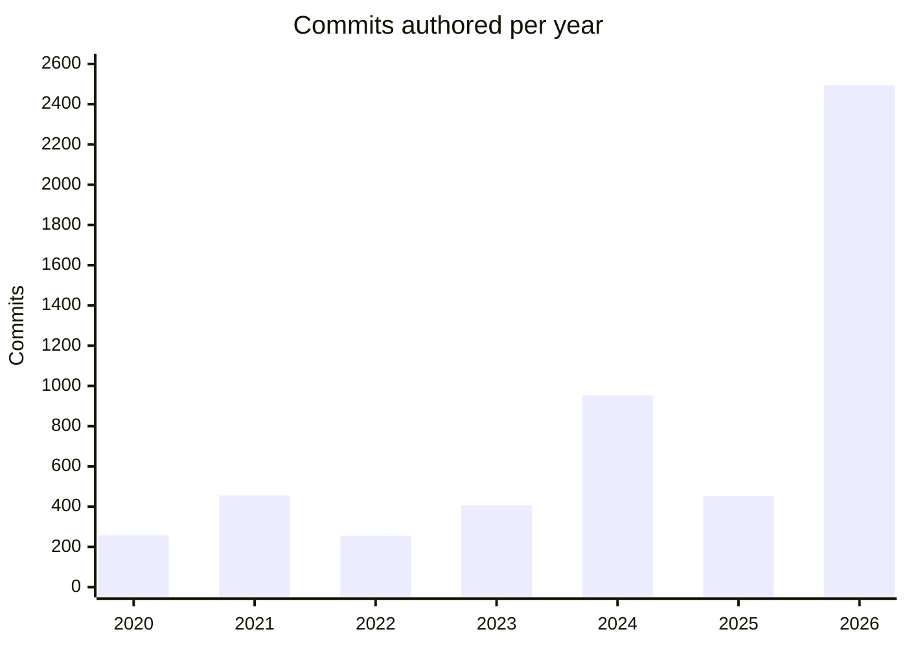
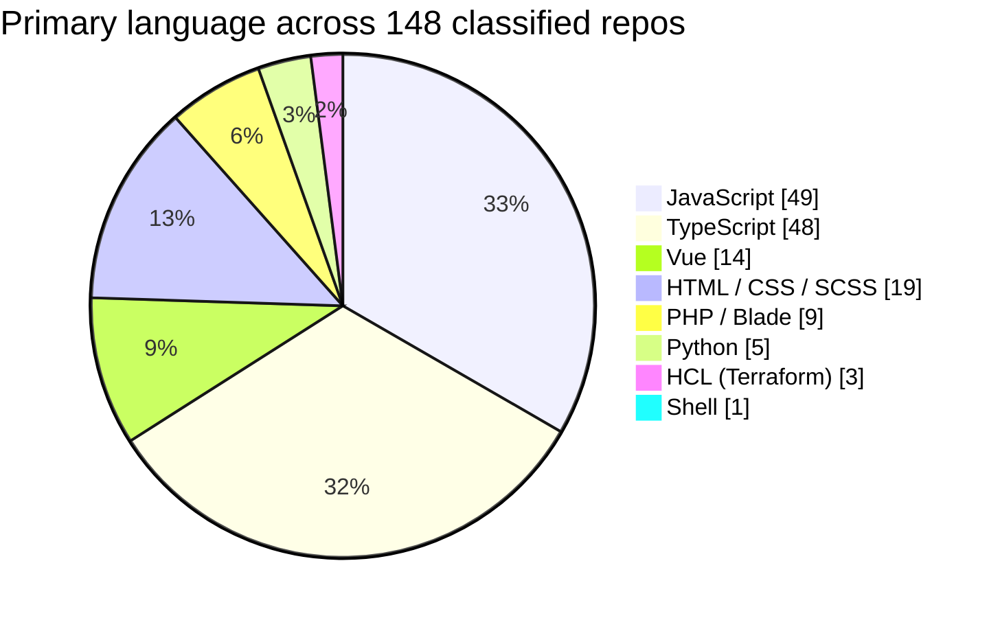

# Ubong Eduok

  

  
  
  

  
  
  
  

I design and ship **end-to-end products**: the backend services, the data model, the web and mobile clients, the admin tooling and the cloud infrastructure underneath. My work centres on systems where money, trust and real-time state have to be right. That means double-entry ledgers, payment webhooks, wallet logic, matching engines and the operational dashboards that keep them running.

---

## Contents

- [GitHub analytics](#github-analytics)
- [Flagship products](#flagship-products)
- [Engineering principles](#engineering-principles)
- [Tech stack](#tech-stack)
- [Experience](#experience)
- [Open-source and public work](#open-source-and-public-work)

---

## GitHub analytics

> Snapshot taken **November 2026** from the GitHub API, private repositories included. Most of my production work is in private client and product repos, so public-only widgets undercount it.

### At a glance

| Metric | Value |
|:---|---:|
| Total repositories | **171** |
| Private (product and client work) | 153 |
| Public | 18 |
| Forks | 0 (every repo is original work) |
| Total commits authored | **5,276+** |
| Commits in 2026 so far | 2,494 |
| Repositories created in 2026 | 45 |
| Multi-repo product platforms (featured below) | 8 platforms, 35 repositories |

### Commits per year

| Year | 2020 | 2021 | 2022 | 2023 | 2024 | 2025 | 2026 |
|:---|---:|---:|---:|---:|---:|---:|---:|
| Commits | 258 | 456 | 256 | 406 | 952 | 453 | **2,494** |

### Repositories created per year

| Year | 2019 | 2020 | 2021 | 2022 | 2023 | 2024 | 2025 | 2026 |
|:---|---:|---:|---:|---:|---:|---:|---:|---:|
| New repos | 2 | 12 | 16 | 29 | 26 | 19 | 22 | **45** |

### Primary language by repository

### Live activity

  

  

---

## Flagship products

Each product below is a **multi-repo platform** I architected and built: backend, web, mobile, admin and, where needed, infrastructure-as-code. The source is private. I'm happy to walk through architecture and code in an interview.

| Product | Domain | Repos | Surface area |
|:---|:---|:---:|:---|
| [SureTrada](#suretrada) | AI prediction marketplace | 7 | Web, admin v1/v2, mobile, landing pages, Terraform platform |
| [Esumoni](#esumoni) | Fintech: cooperative and ajo savings | 4 | NestJS backend + infra, mobile, web, back-office |
| [Winovaa](#winovaa) | Skill gaming and fantasy sports | 3 | Player PWA, staff admin, mobile |
| [Scholora](#scholora) | EdTech: live tutoring for ages 5–17 | 6 | Microservices backend, web, admin, student and tutor apps |
| [WagerVerse](#wagerverse) | Competitive gaming wagers | 4 | Web, admin, Terraform IaC, observability |
| [RentSafeDirect](#rentsafedirect) | PropTech marketplace | 4 | Web, two backend generations, mobile |
| [Caretakeer](#caretakeer) | Agent-free property rentals | 3 | Web, mobile, landing |
| [Floki](#floki) | Mobility and ride-hailing | 4 | Backend, rider app, driver app, admin |

---

### SureTrada

**AI-powered prediction marketplace.** My longest-running product (2024 to present).

- **Repos:** `suretrada-webapp` · `suretrada-admin` · `suretrada-admin-v2` · `suretrada-mobile` · `suretrada` · `suretrada_landing` · `Suretrada-platform`
- **Stack:** Next.js 15, React 19, TypeScript, Tailwind CSS 4, React Native, Terraform (HCL)
- **What I built**
  - The user web app, a rebuilt second-generation admin console and a cross-platform mobile client
  - Wallet, payment and settlement flows, plus real-time analytics on user activity
  - A dedicated `Suretrada-platform` Terraform repo, so environments are reproducible and reviewable
  - Supply-chain safety gates (a malware scan in `predev`, `prebuild` and `lint` hooks) that fail the build on suspicious code

### Esumoni

**Group savings people can trust.** Every cooperative and ajo (esusu) circle gets its own real account at a partner bank, with a live, auditable record of who paid what.

- **Repos:** `esumoni_backend` · `esumoni_mobile` · `esumoni_web` · `esumoni_admin`
- **Stack:** NestJS modular monolith in an Nx monorepo · PostgreSQL 16 (RDS) · Redis 7 · AWS ECS Fargate (af-south-1) · SNS/SQS with a transactional outbox · Temporal Cloud · Terraform · OpenTelemetry, Grafana and Sentry · React Native (Expo)
- **Architecture highlights**
  - **No-custody money model:** funds move only from member bank to the group's account at the partner bank and back to a member bank. The platform never holds a spendable balance.
  - **Immutable double-entry ledger** in integer kobo with enforced invariants, reconciled to the kobo against the bank every day
  - 16 domain modules (auth, identity/KYC, ledger, collections, payout saga, maker-checker approval, trust score, risk/AML and more) behind 4 deployables
  - **Security model:** device-bound key pairs sign every money action, plus maker-checker approvals, 24-hour cooling-off periods, SIM-swap protection, field-level PII encryption, and staff who can freeze but never move money
  - Decisions recorded in 28+ ADRs, with STRIDE threat models for every money flow

### Winovaa

**Skill-gaming and fantasy-sports platform** with a player-facing PWA and staff tooling on a shared API gateway.

- **Repos:** `winovaa_dashboard` · `winovaa_admin` · `winovaa_mobile`
- **Stack:** Next.js (App Router) PWA, TypeScript, pnpm, React Native, REST API gateway with JWT role separation
- **Feature modules:** wallet and deposits, Pick-N games, AI predictions, fantasy teams, PvP matches, and an Aviator-style crash game
- **Engineering details:** installable PWA (offline support, service worker, push), money handled only as integer minor units, UTC-first time handling for kickoff and lock windows, strict player and admin route isolation

### Scholora

**EdTech platform for learners aged 5–17** with recorded courses, live 1:1 tutoring, payments and AI features.

- **Repos:** `Scholora_backend` · `scholora_web` · `Scholora_admin` · `scholora_students_mobile` · `scholora_tutors_mobile` · `scholora_tutors`
- **Stack:** NestJS, PostgreSQL (pgvector), Redis, MinIO/S3, Docker, LiveKit (live sessions), Cloudflare Stream (video), Next.js, React Native
- **Architecture highlights**
  - Five services built from one image (gateway, identity, learning, commerce, media). Each has **its own restricted Postgres role** and can only touch the tables it owns.
  - Guardian-managed child identities with PIN sessions, and an asymmetric JWT signing key held only by the identity service
  - Payment webhooks with signature verification and an idempotent inbox, plus a ledger and tutor payouts
  - Forward-only checksummed SQL migrations, SQL-level isolation and ownership tests, and end-to-end smoke tests through the gateway

### WagerVerse

**Competitive gaming wager platform** where players stake on head-to-head matches.

- **Repos:** `wagerverse_web` · `wager_admin` · `wagerers_IAC` · `wagerers_observables`
- **Stack:** Next.js (App Router), TypeScript, Terraform (HCL), dedicated observability stack
- **What I built:** the user dashboard and admin console, an API client with bearer tokens and automatic refresh-on-401, infrastructure-as-code for every environment, and a separate observability repo for metrics, logs and alerting

### RentSafeDirect

**Property marketplace** for finding homes to rent and buy, on web and mobile.

- **Repos:** `rentsafedirect` · `rentsafedirect_backend` · `rentsafe_backend` · `rentsafe_mobile`
- **Stack:** Node.js, Express, Sequelize and MySQL, Redis, Socket.io, AWS S3, Firebase, OpenAI and LangChain, Tesseract OCR, Puppeteer, Flutterwave and Coinbase Commerce, Twilio, Sentry, Swagger, React Native
- **What I built**
  - Real-time messaging between renters and landlords, OTP verification, and payments in both fiat and crypto
  - AI-assisted document processing (OCR, PDF parsing and generation) and content moderation
  - A performance and load-testing toolkit (k6, Artillery, ApacheBench) with Sentry and Slack alerting

### Caretakeer

**Agent-free rental platform** with verified listings, transparent pricing and a marketplace that connects artisans with property owners.

- **Repos:** `caretakeer-web` · `caretakeer-mobile` · `caretakeer-landing`
- **Stack:** Next.js 16 (Turbopack), React, Tailwind CSS, Framer Motion, Firebase Auth, React Native

### Floki

**Mobility platform** with separate apps for riders and drivers and an operations console. This product is in active early development (started November 2026).

- **Repos:** `floki_backend` · `floki_riders` · `floki_driver` · `floki_admin`
- **Scope:** trip matching, live location tracking, driver onboarding and fleet operations, building on matching and real-time patterns from earlier ride-matching work at Booki

---

## Engineering principles

These patterns recur across the platforms above:

| Principle | How it shows up |
|:---|:---|
| **Money is integers** | Kobo and minor units everywhere, double-entry ledgers, daily reconciliation |
| **Idempotency by default** | Webhook inboxes, idempotency keys, outbox-driven events |
| **Least privilege** | Per-service database roles, separated signing keys, staff who can freeze but never move funds |
| **Decisions are written down** | ADRs, threat models, runbooks and task docs live next to the code |
| **Infrastructure as code** | Terraform for SureTrada, WagerVerse, Booki and Esumoni |
| **Supply-chain hygiene** | Malware-scan gates in build hooks, `npm audit` in CI, pinned dependencies |

---

## Tech stack

| Area | Tools |
|:---|:---|
| **Languages** | TypeScript, JavaScript, Python, PHP, SQL, Bash, HCL |
| **Frontend** | Next.js (App Router), React, Vue, Tailwind CSS, Framer Motion, PWA |
| **Mobile** | React Native, Expo |
| **Backend** | NestJS, Node.js, Express, Laravel, Flask, Socket.io |
| **Data** | PostgreSQL (incl. pgvector), MySQL, MongoDB, Redis, Sequelize |
| **Messaging and workflows** | SNS/SQS, transactional outbox, Temporal, cron workers |
| **Cloud and DevOps** | AWS (ECS Fargate, RDS, S3, CloudFront, ElastiCache), Docker, Terraform, GitHub Actions, Nginx, PM2 |
| **Observability** | OpenTelemetry, Grafana, Sentry, Winston |
| **Payments and integrations** | Flutterwave, Coinbase Commerce, bank and NIP adapters, Twilio, Mailgun, Firebase |
| **AI** | OpenAI, LangChain, Tesseract OCR, TensorFlow.js |
| **Web3** | Solidity, ethers, wallet integrations |

  

---

## Experience

### Senior Full-Stack Engineer · SureTrada
*2023 – Present*
- Built and evolved an AI-powered prediction marketplace across web, mobile, admin and infrastructure
- Owned payment and wallet flows, analytics dashboards and platform tooling
- Led the second-generation admin rebuild and moved infrastructure to Terraform

### Full-Stack Engineer · Stately VIP
*2025 – Present*
- Delivered a premium chauffeur and security booking platform with real-time GPS tracking
- Built partner dashboards and secure operational workflows
- Containerised services and automated deployments

### Full-Stack Engineer · RentSafeDirect
*2024 – Present*
- Built the multi-platform property marketplace for web and mobile
- Shipped real-time chat, payments, OCR document processing and load-testing tooling

### Backend Engineer · Booki
*2024 – 2025*
- Delivered the MVP of a location-based ride-matching platform
- Built matching logic, payment workflows and Terraform infrastructure (`bookie-iAC`)

### Other products shipped
Stately VIP · Spoovest (investment platform: web, admin, mobile) · Blaqplate · Korixa Labs · Proeditech (multi-tenant school management) · Tejj Collections (e-commerce) · Oswald · FlipEX admin

---

## Open-source and public work

| Repository | Description | Stack |
|:---|:---|:---|
| [devops-deploy-toolkit](https://github.com/mascot200/devops-deploy-toolkit) | Deployment automation scripts | Shell |
| [crowdFundingWeb3](https://github.com/mascot200/crowdFundingWeb3) | Decentralised crowdfunding dApp | Solidity, React |
| [crypto_web3_app](https://github.com/mascot200/crypto_web3_app) | Send ETH from a wallet to any address | React, Tailwind, Solidity |
| [wayaCoinSwap](https://github.com/mascot200/wayaCoinSwap) | ETH transfer dApp | Next.js, Solidity, Sanity |
| [web3_twitter_clone](https://github.com/mascot200/web3_twitter_clone) | Web3 social feed | Next.js, Solidity, Sanity |
| [wayaChat](https://github.com/mascot200/wayaChat) | Real-time chat application | TypeScript |
| [redditCloneApi](https://github.com/mascot200/redditCloneApi) | REST API for a Reddit-style forum | Node.js |
| [mern-backend](https://github.com/mascot200/mern-backend) · [mern-frontend](https://github.com/mascot200/mern-frontend) | Travel-sharing social platform | MERN |
| [betcalculator](https://github.com/mascot200/betcalculator) | Betting odds calculator | JavaScript |
| [DSA](https://github.com/mascot200/DSA) | Data structures and algorithms practice | JavaScript |
| [devops-roadmap](https://github.com/mascot200/devops-roadmap) · [cybersecurity-roadmap](https://github.com/mascot200/cybersecurity-roadmap) | Learning roadmaps | — |

[Browse all repositories →](https://github.com/mascot200?tab=repositories)

---

## Education

- **University of Benin**: Maritime Studies and ICT
- Ongoing focus areas: distributed systems, financial ledgers, cloud architecture and application security

## Open to

- Senior or staff product engineering roles
- Technical leadership and architecture work
- Fintech, marketplace, EdTech and platform teams building systems that must be correct at scale

---

  <strong>Let's build systems that scale, perform and matter.</strong> 
  <a href="https://linkedin.com/in/ubong-eduok-b728b69b">LinkedIn</a> ·
  <a href="https://github.com/mascot200">GitHub</a> ·
  <a href="mailto:ubongeduok33@gmail.com">Email</a>

